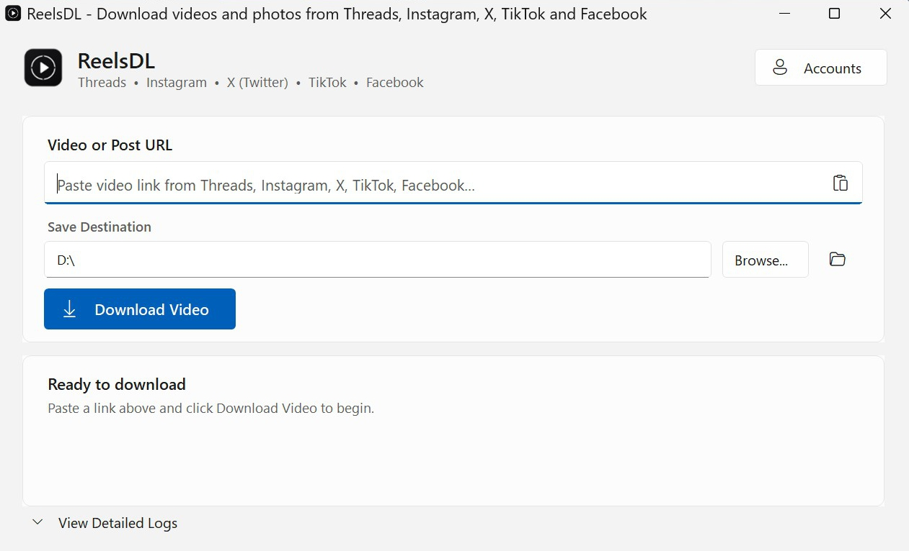

# ReelsDL - Universal Short Video Downloader

Fast, standalone Windows desktop application to download videos and photos from **Threads, Instagram, X (Twitter), TikTok, and Facebook** in the highest quality the platform exposes (MP4 / WebM / JPG).

Powered by browser-native automation (Chrome DevTools Protocol), **ReelsDL reuses your own browser session**, so posts that are visible after logging in can be downloaded without extracting passwords or API tokens.

[](LICENSE)
[](#installation)
[](https://github.com/JasonMMIV/ReelsDL/releases)

---

## Screenshot

<p align="center">
  
</p>

<p align="center"><em>Paste a link, choose a destination, and download the best progressive video or photo.</em></p>

---

## Supported Platforms

| Platform | URL Formats | Highlights |
|---|---|---|
| **Instagram** | `instagram.com/reel/...`<br>`instagram.com/p/...` | Reels, Feed videos, and multi-slide carousels. Bypasses `blob:` streams. |
| **Threads** | `threads.com/@user/post/...` | Single videos and multi-photo/video albums exposed by the post page. |
| **X (Twitter)** | `x.com/user/status/...`<br>`twitter.com/...` | Extracts the highest-bitrate progressive MP4, or every photo in a multi-photo post. |
| **TikTok** | `tiktok.com/@user/video/...`<br>`tiktok.com/@user/photo/...`<br>`vt.tiktok.com/...` | Videos, photo slideshows, canonical links, and `vt.tiktok.com` short links. |
| **Facebook** | `facebook.com/reel/...`<br>`fb.watch/...` | Facebook Reels and videos with HD progressive stream priority. |

---

## Installation

**Prerequisite:** Google Chrome or Microsoft Edge must be installed. ReelsDL drives the browser already on your PC and does not bundle one.

Run the Windows installer located in `dist\ReelsDL-Setup.exe` (build it first with `build.ps1` if you cloned the source):

1. Launch **`ReelsDL-Setup.exe`**.
2. Select your desired installation location (default: `%LOCALAPPDATA%\Programs\ReelsDL`).
3. Click **Install**.
4. The installer creates:
   - **Desktop Shortcut** (`ReelsDL.lnk`)
   - **Start Menu Shortcut** (`ReelsDL`)
   - **Windows Add/Remove Programs** registration (for clean uninstallation via Windows Settings)

If a shortcut or registry entry cannot be created, setup still completes but reports the problem instead of claiming full success. Close ReelsDL before installing or uninstalling; the installer asks for confirmation if the app is running.

---

## How to Use

1. Launch **`ReelsDL`** from your desktop shortcut or Start Menu.
2. Paste any supported post or video URL.
3. Click **Download Video**.
4. Files are saved to:  
   `C:\Users\<YourUsername>\Downloads\ReelsDL`

While a job is running, the activity card offers **Cancel**. Closing the window
also asks whether to stop the current task.

---

## Private & Login-Required Posts

### Method 1: Automatic Detection (Recommended)
Paste a restricted or private URL and click **Download Video**.  
If the post requires login, ReelsDL shows a **Login Required** notice with a **Log In Now** action. After you log in and close the browser window, ReelsDL retries the same download automatically.

### Method 2: Manual Login
1. Click **Account Login** (the button dynamically reflects the pasted platform name, e.g., `Login Instagram`, `Login X`).
2. Complete login in the isolated browser window and close it.
3. Your browser session is cached in `%LOCALAPPDATA%\ReelsDL\profile`. Cookie values remain encrypted by Chromium using Windows DPAPI; ReelsDL only inspects cookie names, host domains, and expiry metadata to detect whether a session exists.

---

## Development & Building

This repository is the project workspace / source repository.
`ReelsDL.ps1` is a **console-only engine**; the desktop UI lives in
`ReelsDL.exe` (`MainForm.cs` + the Fluent toolkit).

```powershell
# Build the application, uninstaller, and Windows Installer (runs self-tests):
powershell -ExecutionPolicy Bypass -File .\build.ps1

# Build and immediately launch the development version:
powershell -ExecutionPolicy Bypass -File .\build.ps1 -Run

# Clean build artifacts:
powershell -ExecutionPolicy Bypass -File .\build.ps1 -Clean

# Offline engine checks (no Chrome, no network):
powershell -ExecutionPolicy Bypass -File .\src\ReelsDL.ps1 -SelfTest
```

The compiled installer will be output to:
`dist\ReelsDL-Setup.exe`

---

## Command-Line Interface (CLI)

```powershell
# Direct download to a custom folder
powershell -NoProfile -ExecutionPolicy Bypass -File .\src\ReelsDL.ps1 `
  -Cli -Url "https://www.instagram.com/reel/xxxx/" -Out "D:\Videos"

# Launch login window for a specific platform
powershell -NoProfile -ExecutionPolicy Bypass -File .\src\ReelsDL.ps1 `
  -Login -Platform "Instagram"
```

Exit codes: `0` success, `1` error, `2` login window closed without a session,
`3` login required (`-Cli` only). Run with `-Help` for the full usage text.

---

## License

Released under the [MIT License](LICENSE). ReelsDL is an independent project and is not affiliated with Meta, X, TikTok, or Google.

---

## Developer & Maintainer Documentation

For technical specifications, architecture diagrams, and CDP protocols, refer to [MAINTAINER_GUIDE.md](MAINTAINER_GUIDE.md).
